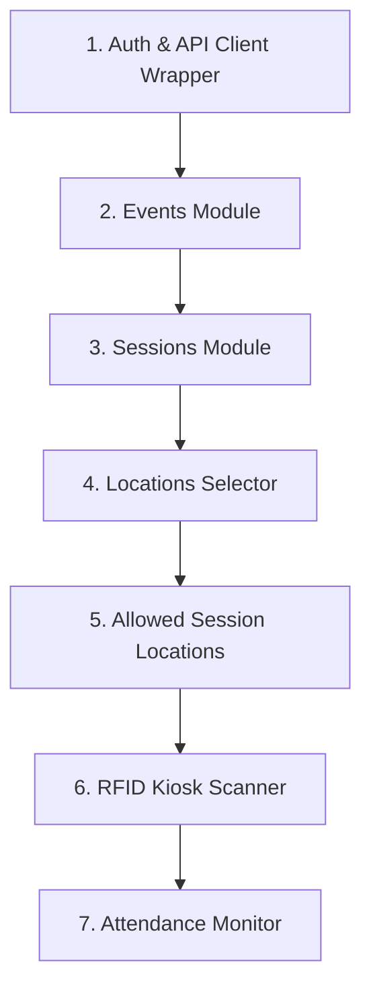

# Frontend Handoff Package: RFID Attendance System

**Version:** 1.0.0-rc1  
**Target Environment:** Local (`http://localhost:3000`) & Supabase Staging  
**Contract Baseline:** `docs/RFID_Attendance_System_API_Contract.md`  
**Current Backend Status:** All 9 endpoints implemented and 100% contract verified (58/58 tests passing).

---

## 1. Endpoint Status & Readiness Board

This status table acts as the source of truth for the Frontend team.

| Method | Endpoint Path | Auth Required | Implemented | Automated Tests | Postman QA | Ready for FE? |
| :---: | :--- | :---: | :---: | :---: | :---: | :---: |
| `GET` | `/health` | Public | Yes | 72/72 passing | Verified | 🟢 **Ready** |
| `POST` | `/api/v1/auth/login` | Public | Yes | 72/72 passing | Verified | 🟢 **Ready** |
| `POST` | `/api/v1/auth/logout` | Authenticated | Yes | 72/72 passing | Verified | 🟢 **Ready** |
| `GET` | `/api/v1/auth/me` | Authenticated | Yes | 72/72 passing | Verified | 🟢 **Ready** |
| `POST` | `/api/v1/auth/change-password` | Authenticated | Yes | 72/72 passing | Verified | 🟢 **Ready** |
| `GET` | `/api/v1/student/dashboard` | Student | Yes | 72/72 passing | Verified | 🟢 **Ready** |
| `GET` | `/api/v1/student/attendance` | Student | Yes | 72/72 passing | Verified | 🟢 **Ready** |
| `GET` | `/api/v1/student/sessions/:id/checkpoints` | Student | Yes | 72/72 passing | Verified | 🟢 **Ready** |
| `GET` | `/api/v1/student/notifications` | Student | Yes | 72/72 passing | Verified | 🟢 **Ready** |
| `GET` | `/api/v1/events` | Admin | Yes | 72/72 passing | Verified | 🟢 **Ready** |
| `POST` | `/api/v1/events` | Admin | Yes | 72/72 passing | Verified | 🟢 **Ready** |
| `GET` | `/api/v1/events/:eventId/sessions` | Admin | Yes | 72/72 passing | Verified | 🟢 **Ready** |
| `POST` | `/api/v1/events/:eventId/sessions` | Admin | Yes | 72/72 passing | Verified | 🟢 **Ready** |
| `PATCH` | `/api/v1/sessions/:sessionId` | Admin | Yes | 72/72 passing | Verified | 🟢 **Ready** |
| `GET` | `/api/v1/locations` | Admin | Yes | 72/72 passing | Verified | 🟢 **Ready** |
| `PUT` | `/api/v1/sessions/:sessionId/locations` | Admin | Yes | 72/72 passing | Verified | 🟢 **Ready** |
| `POST` | `/api/v1/attendance/scan` | Admin | Yes | 72/72 passing | Verified | 🟢 **Ready** |
| `GET` | `/api/v1/sessions/:sessionId/attendance` | Admin | Yes | 72/72 passing | Verified | 🟢 **Ready** |

> *Status: All 17 endpoints across Admin RFID operations, Authentication, and Student Portal are 100% implemented, verified with automated tests (72/72 passing), and connected to Frontend services.*

---

## 2. Environment & Network Setup

### 2.1 Base URLs
- **Local Development:** `http://localhost:3000/api/v1`
- **Health Probe:** `http://localhost:3000/health` (no authentication needed)

### 2.2 Authentication Header
All routes under `/api/v1/*` require an active Supabase Bearer token belonging to a user with role `super_admin` or `admin`.
```http
Authorization: Bearer <supabase_access_token>
Content-Type: application/json
```

### 2.3 Universal Response Envelopes
The backend guarantees deterministic response envelopes. The frontend should unwrap `success`:

#### On Success (`HTTP 200 / 201`):
```json
{
  "success": true,
  "data": { ... }
}
```

#### On Failure (`HTTP 400 / 401 / 403 / 404 / 409 / 500`):
```json
{
  "success": false,
  "error": {
    "code": "duplicate_attendance",
    "message": "Student has already recorded Time-In for this session."
  }
}
```

---

## 3. Recommended Step-by-Step Integration Order

Build and connect your UI screens in this sequence. Each step depends on the previous step:



### Step 1: Client Setup & Auth Interceptor
- Configure Axios or Fetch interceptor to inject `Authorization: Bearer ${token}`.
- Add an error interceptor that redirects to Login on HTTP `401 unauthorized`.

### Step 2: Events Management
- Screens: Event List, Create Event Dialog.
- Endpoints: `GET /api/v1/events`, `POST /api/v1/events`.
- Fields: `name`, `description` (optional), `start_date` (`YYYY-MM-DD`), `end_date` (`YYYY-MM-DD`).

### Step 3: Attendance Sessions
- Screens: Event Details $\rightarrow$ Sessions Tab, Session Creation Modal.
- Endpoints: `GET /api/v1/events/:eventId/sessions`, `POST /api/v1/events/:eventId/sessions`, `PATCH /api/v1/sessions/:sessionId`.
- Time formats: Strict `HH:mm:ss` (e.g., `07:00:00`).

### Step 4 & 5: Locations & Allowed Session Locations
- Screens: Room/Gate selector per session.
- Endpoints:
  - `GET /api/v1/locations` (fetch all campus locations).
  - `PUT /api/v1/sessions/:sessionId/locations` (save allowed `time_in_location_ids` and `time_out_location_ids`).

### Step 6: Kiosk RFID Scanner Screen
- Screens: Fullscreen RFID scan kiosk.
- Endpoint: `POST /api/v1/attendance/scan`.
- Payload:
  ```json
  {
    "rfid_uid": "04A37B91",
    "session_id": "sessionId",
    "location_id": "locationId",
    "type": "time_in"
  }
  ```

### Step 7: Session Attendance Monitor
- Screens: Real-time attendance log / table.
- Endpoint: `GET /api/v1/sessions/:sessionId/attendance`.
- Displays: Student ID, Student Name, Attendance Type, Location, Timestamp.

---

## 4. Error Code & UI Reaction Reference

When `res.success === false`, switch on `res.error.code` to show targeted UI feedback:

| `error.code` | HTTP | UI Meaning | Recommended UI Component & Sound |
| :--- | :---: | :--- | :--- |
| `duplicate_attendance` | `409` | Student already swiped for this type. | 🟡 **Yellow Toast / Warning Banner** + Warning Buzzer |
| `unknown_rfid` | `400` | RFID badge is not linked to any student. | 🔴 **Red Toast / Modal** + Error Buzzer |
| `outside_time_window` | `400` | Current server time is outside session schedule. | ⏱️ **Orange Info Toast**: *"Session closed"* |
| `invalid_location` | `400` | Scanner location not permitted for this session. | 🚫 **Alert Dialog**: *"Scanner location mismatch"* |
| `invalid_session_date` | `400` | Session date is outside event start/end date. | ⚠️ Form field validation error |
| `invalid_session_period` | `400` | Time intervals are inverted or overlapping. | ⚠️ Form field validation error |
| `duplicate_session` | `409` | Session with same event, date, name exists. | ⚠️ Form error: *"Session name already used"* |
| `session_not_found` | `404` | Session ID does not exist. | 🔍 404 Empty State / Redirect |
| `event_not_found` | `404` | Event ID does not exist. | 🔍 404 Empty State / Redirect |
| `unauthorized` | `401` | Missing or expired token. | 🔒 Clear storage & redirect to `/login` |
| `forbidden` | `403` | Non-admin attempting admin operation. | ⛔ Access Denied screen |

---

## 5. Kiosk Scanner UI Best Practices

1. **Hardware Debounce / Input Locking:**
   When an RFID scanner emits a badge string (via virtual keyboard keystroke or serial port), **lock the UI input for 500ms** to prevent multiple keystrokes from firing concurrent duplicate HTTP calls from the browser.
2. **Server-Side Timestamp Authority:**
   Never send a client timestamp from the browser. The backend generates and writes the authoritative timestamp in Philippine Standard Time (`+08:00`).
3. **Immediate Visual Feedback:**
   - On `201 Created`: Flash screen **Green** for 1.5s, display student name and photo, play positive chime.
   - On `409 duplicate_attendance`: Flash screen **Yellow** for 1.5s, display *"Already Checked In"* warning.
   - On `400 unknown_rfid`: Flash screen **Red** for 2s, display *"Unrecognized Card"*.

---

## 6. Deferred Features (Do NOT Build in Current Phase)

To keep scope clean and focused, the backend does **not** support the following in this phase:
- **Student Feedback Submission Endpoint:** Explicitly removed / deferred for now per Product Lead decision.
- **Manual Session Re-opening:** Attendance schedule is strictly time-window driven.
- **Attendance Corrections / Deletion:** Immutable audit log in current phase.
- **Location Creation / Renaming:** Managed via database seeds / migrations.
- **Bulk CSV Imports:** Reserved for future administrative bulk utilities.
