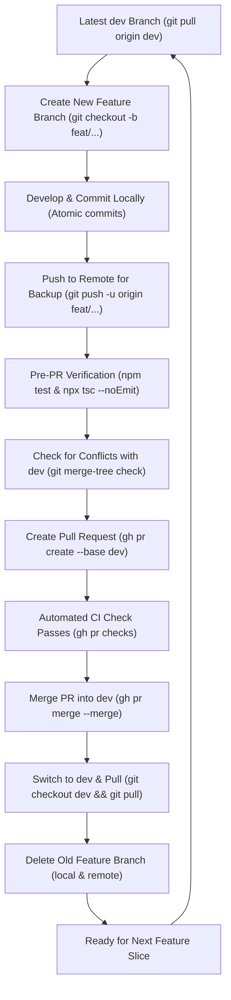

# Standard Git Feature Branching & PR Workflow

**Applies to:** Backend (`RFID_attendance_BE`) & Frontend (`RFID_attendance_FE`)  
**Target Integration Branch:** `dev`  
**Production / Staging Release Branch:** `main`

---

## 1. Overview & Core Philosophy

1. **`dev` is the Protected Baseline**: Never commit or push directly to `dev`. All changes must enter `dev` through a reviewed, tested Pull Request (PR).
2. **One Feature Slice per Branch**: Branches must have a focused scope (e.g., `feat/student-auth-portal`, `feat/student-profile-settings`).
3. **Verify Before PR**: Every PR must pass all unit tests, typechecks, and conflict dry-runs before merging.
4. **Clean House Post-Merge**: Once a PR is merged into `dev`, the feature branch must be deleted both locally and remotely to prevent stale branch accumulation.
5. **Fresh Branching Always**: A new feature branch must always branch off the latest updated `dev`.

---

## 2. Visual Workflow Lifecycle



---

## 3. Step-by-Step Command Reference

### Phase 1: Starting a New Feature Slice

Always start from a fresh, updated `dev`:

```powershell
# 1. Switch to dev
git checkout dev

# 2. Pull latest upstream changes
git pull origin dev

# 3. Create and switch to new feature branch
git checkout -b feat/<feature-name>

# 4. Set upstream tracking on remote origin
git push -u origin feat/<feature-name>
```

---

### Phase 2: Development & Incremental Backup

During active coding:

```powershell
# Check working tree
git status

# Stage atomic changes
git add <files>

# Commit with conventional message
git commit -m "feat(<scope>): describe work completed"

# Push incremental progress to remote origin for safe backup
git push origin feat/<feature-name>
```

---

### Phase 3: Pre-PR Quality & Conflict Verification

Before opening any PR, run all checks locally:

```powershell
# 1. Backend verification:
npm test
npm run typecheck

# 2. Frontend verification:
npx tsc --noEmit

# 3. Fetch latest dev and verify zero merge conflicts:
git fetch origin dev
git merge-tree --write-tree origin/dev HEAD
# Output must exit with code 0 and show no conflict markers.
```

---

### Phase 4: Create Pull Request & Await CI

Use the GitHub CLI (`gh`) to open the PR targeting `dev`:

```powershell
# Create PR
gh pr create --base dev --head feat/<feature-name> --title "feat: <feature description>" --body "## Summary`n- Item 1`n- Item 2"

# Monitor CI status
gh pr checks <PR_NUMBER>
```

---

### Phase 5: Merging into `dev`

Once CI passes and the conflict check is green:

```powershell
# Merge PR into dev
gh pr merge <PR_NUMBER> --merge
```

---

### Phase 6: Post-Merge Cleanup & Next Task Setup

Clean up the merged branch so your workspace stays spotless:

```powershell
# 1. Switch back to local dev
git checkout dev

# 2. Pull the newly merged code from remote dev
git pull origin dev

# 3. Delete the local merged feature branch
git branch -d feat/<feature-name>

# 4. Delete the remote feature branch on GitHub
git push origin --delete feat/<feature-name>

# 5. Branch fresh for the next task
git checkout -b feat/<next-feature-name>
git push -u origin feat/<next-feature-name>
```

---

## 4. Branch Naming Conventions

| Category | Format | Example |
| :--- | :--- | :--- |
| **New Features** | `feat/<slice-name>` | `feat/student-profile-settings` |
| **Bug Fixes** | `fix/<bug-description>` | `fix/rfid-duplicate-scan-race` |
| **Refactoring** | `refactor/<target>` | `refactor/3-tier-routing` |
| **Documentation** | `docs/<doc-name>` | `docs/api-contract-v2` |
| **Chores / Config** | `chore/<task-name>` | `chore/upgrade-zod-v4` |

---

## 5. Golden Rules for Developers & AI Agents

1. **NEVER** run `git push origin dev` directly without a Pull Request.
2. **NEVER** leave untracked/uncommitted files when switching branches.
3. **NEVER** merge a PR if automated tests (`npm test`) or typechecks (`tsc`) are failing.
4. **ALWAYS** keep Frontend and Backend feature branch names aligned when working on cross-stack slices.
